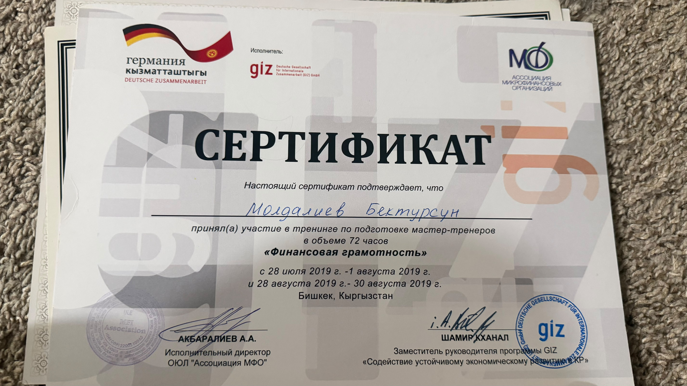
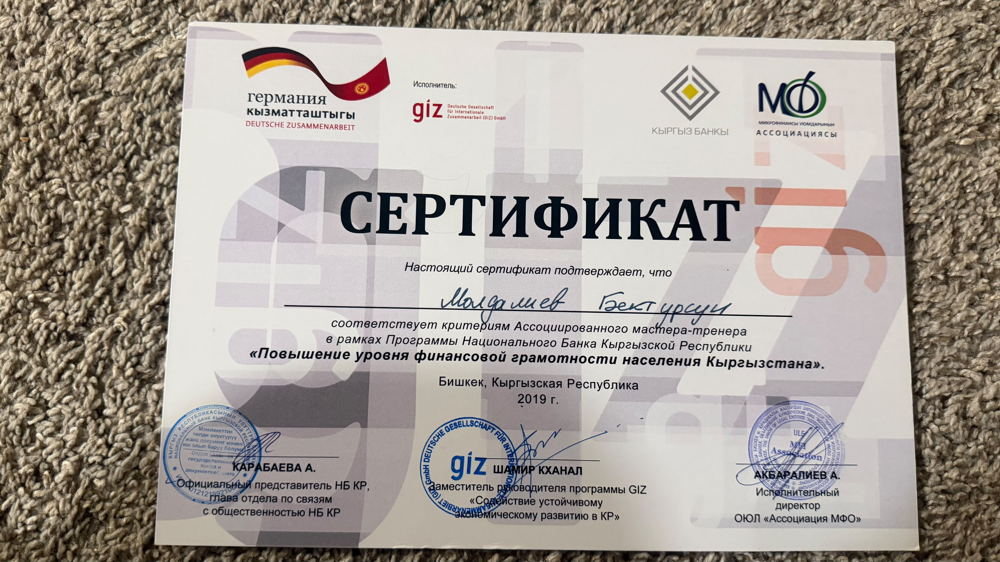
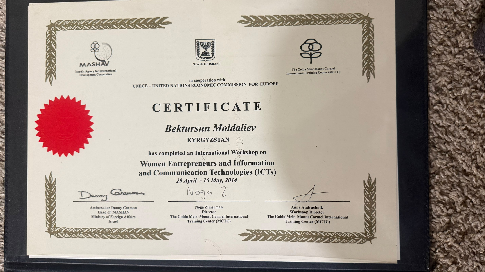
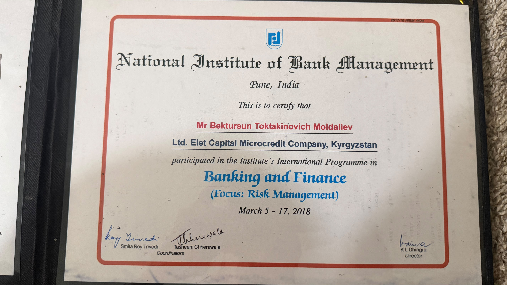
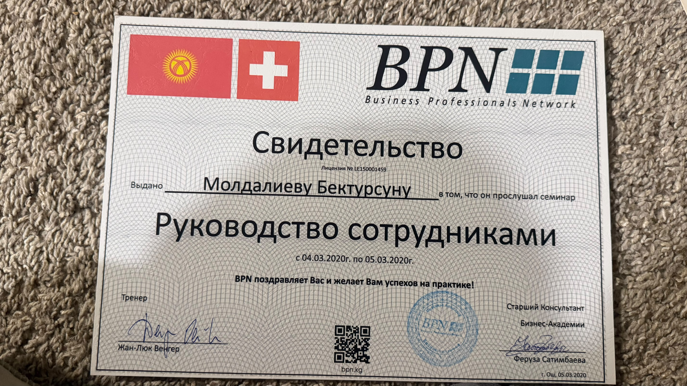
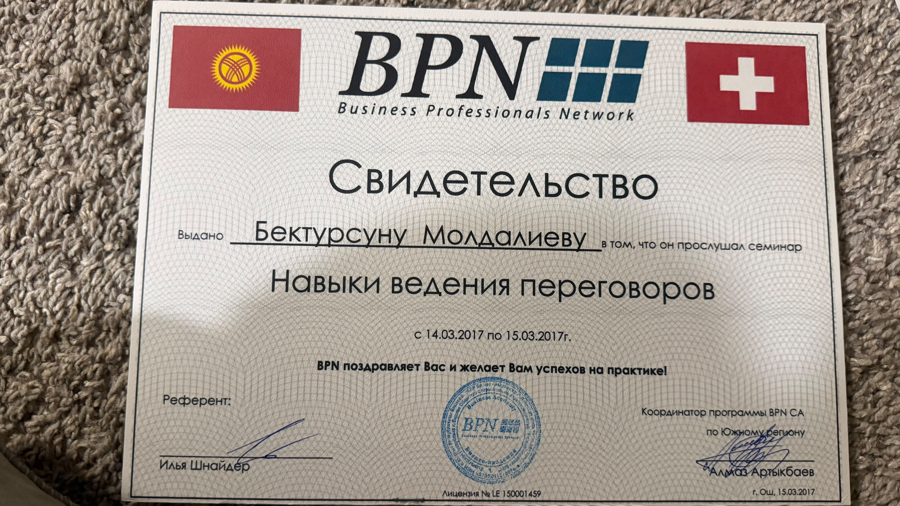
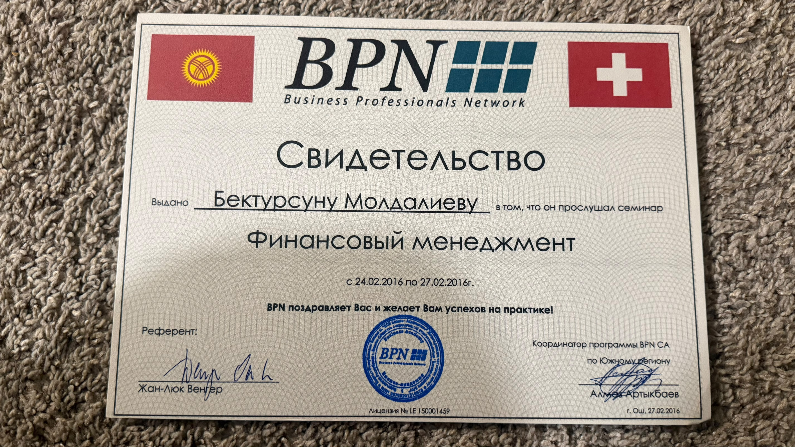
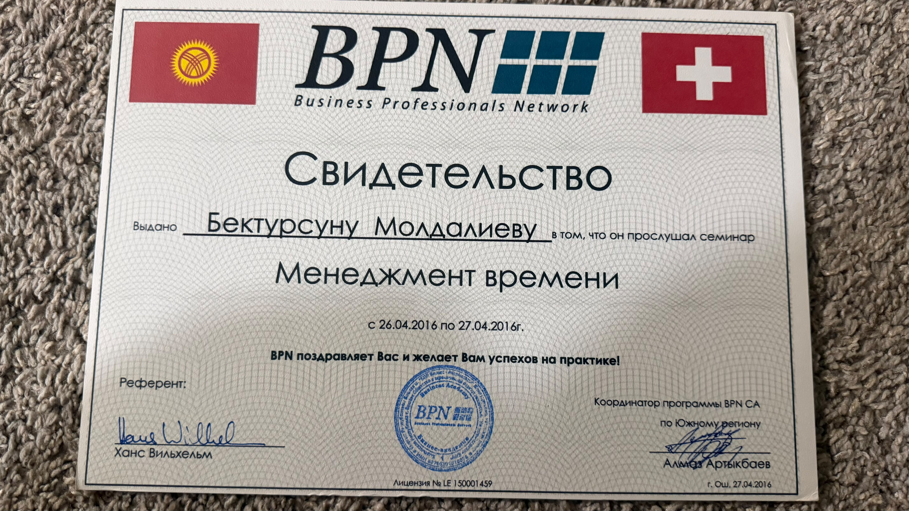
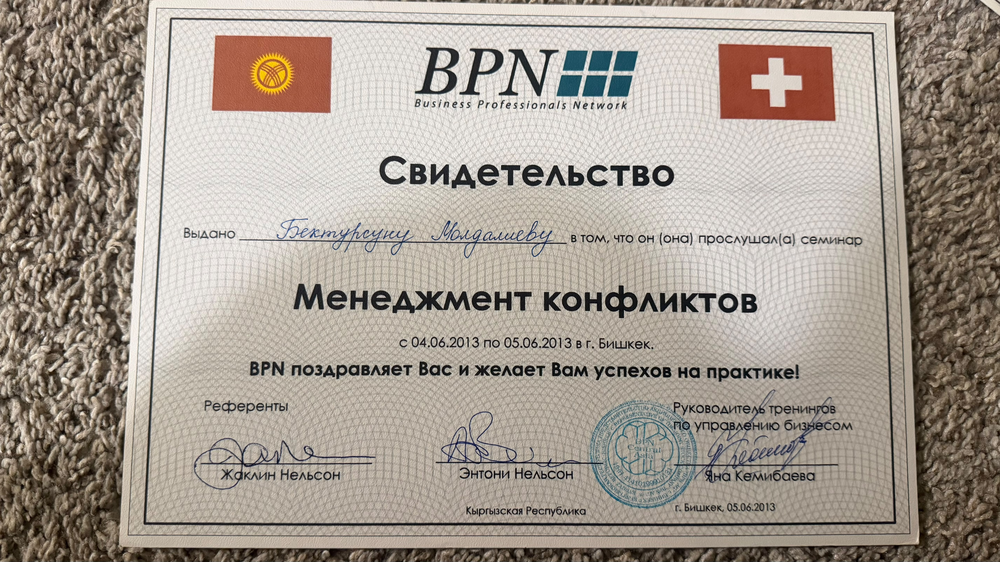

# Professional training

These programs complement my work in small-business lending, microfinance, and branch management in Kyrgyzstan.

## Financial education, entrepreneurship, and banking

| Program | Organization | Location and year |
| --- | --- | --- |
| Financial Literacy Train-the-Trainer Program | National Bank of the Kyrgyz Republic, GIZ, and the Association of Microfinance Organizations | Bishkek, Kyrgyzstan · 2019 |
| Women Entrepreneurs and Information and Communication Technologies | Golda Meir Mount Carmel International Training Center and MASHAV, in cooperation with UNECE | Haifa, Israel · 2014 |
| International Programme in Banking and Finance (Risk Management) | National Institute of Bank Management | Pune, India · 2018 |

I took part in 72 hours of financial literacy training. A separate certificate records that I met the program’s criteria for associate master trainer.

## Management workshops

I attended these workshops through Business Professionals Network.

| Workshop | Location and year |
| --- | --- |
| Managing Employees | Osh, Kyrgyzstan · 2020 |
| Negotiation Skills | Osh, Kyrgyzstan · 2017 |
| Financial Management | Osh, Kyrgyzstan · 2016 |
| Time Management | Osh, Kyrgyzstan · 2016 |
| Conflict Management | Bishkek, Kyrgyzstan · 2013 |

## Certificate photos

Select any photo to open the full-size certificate.

<strong>Financial Literacy Train-the-Trainer Program</strong> · Bishkek, Kyrgyzstan · 2019

 Certificate of participation in the 72-hour training

 Certificate confirming associate master trainer criteria

<strong>Women Entrepreneurs and Information and Communication Technologies</strong> · Haifa, Israel · 2014

 Certificate of workshop completion

<strong>International Programme in Banking and Finance</strong> · Pune, India · 2018

 Certificate of participation in the risk management program

<strong>Business Professionals Network workshops</strong> · Kyrgyzstan · 2013–2020

 Managing Employees · Osh · 2020

 Negotiation Skills · Osh · 2017

 Financial Management · Osh · 2016

 Time Management · Osh · 2016

 Conflict Management · Bishkek · 2013

[Back to my GitHub profile](https://github.com/Bektursun3005#banking-and-microfinance-experience)
